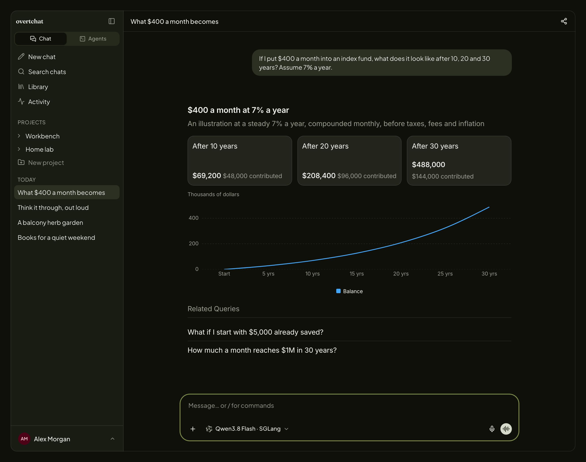
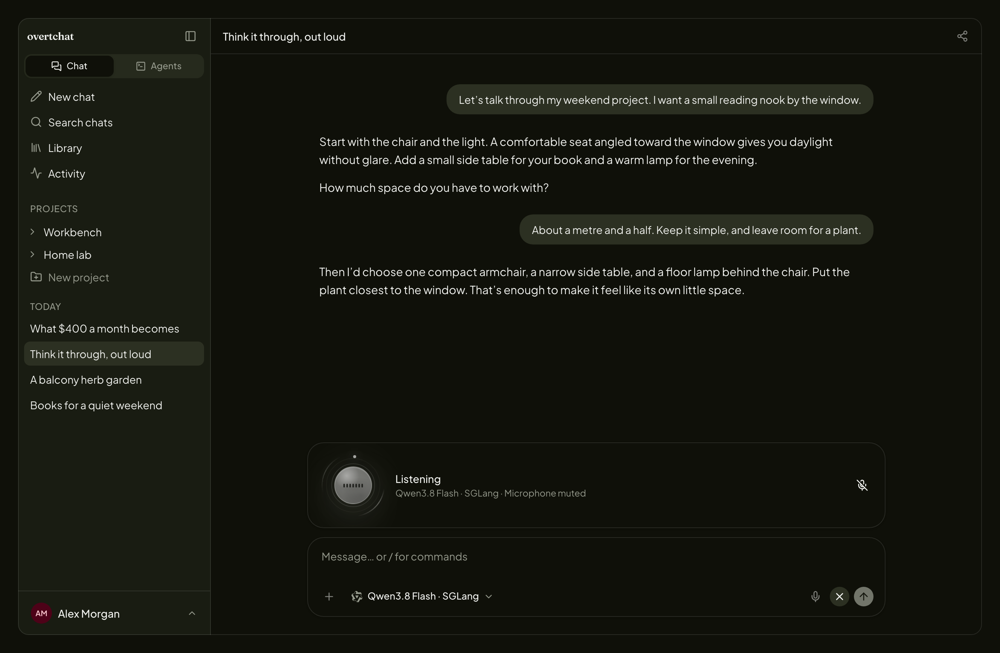
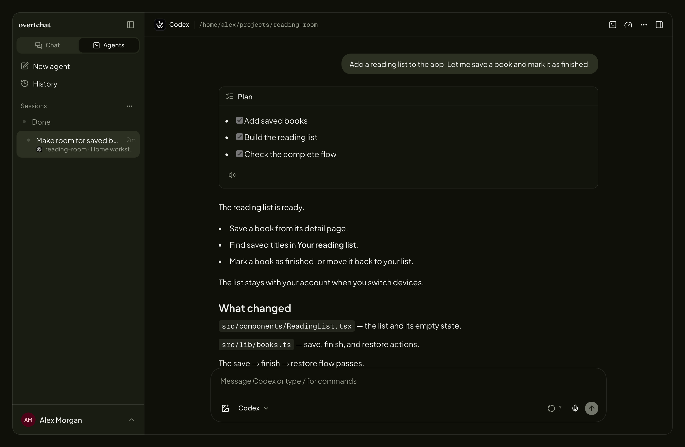
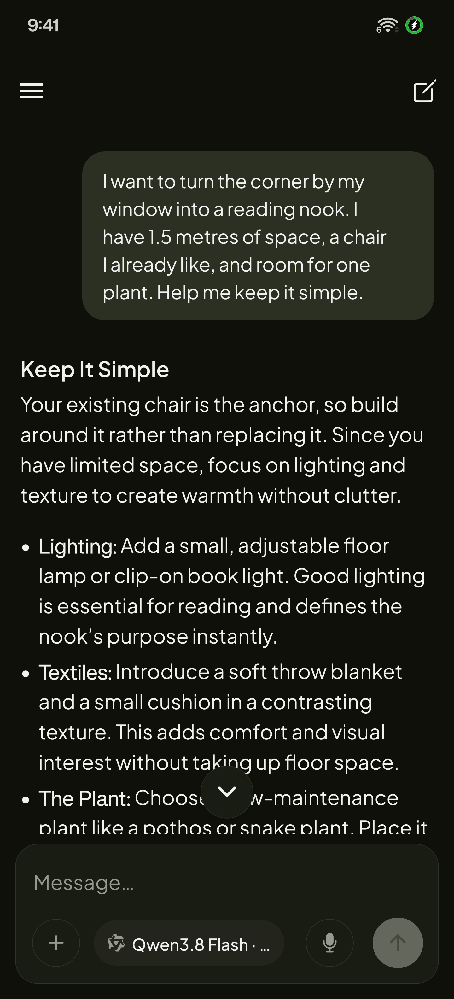
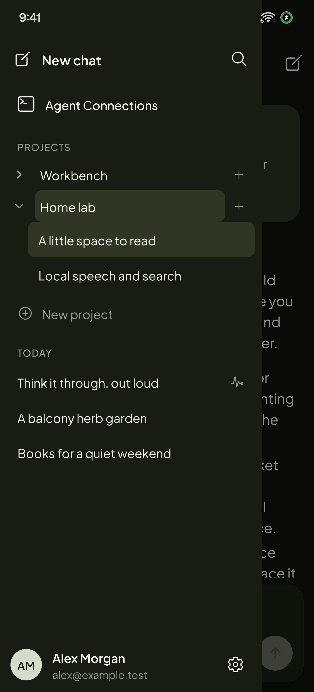

<p align="center">
  
</p>

<p align="center"><strong>Local AI, without the clutter.</strong></p>
<p align="center">Local and hosted models, live voice, and coding agents in one self-hosted app,<br>with native clients for every screen you own.</p>

<p align="center">
  <a href="https://github.com/yoloyash/overtchat/releases"></a>
  <a href="LICENSE"></a>
  <a href="https://overtchat.com/downloads/"></a>
  <a href="https://play.google.com/store/apps/details?id=com.overtchat.mobile"></a>
  <a href="https://apps.apple.com/us/app/overtchat/id6812165221"></a>
</p>

<p align="center">
  <a href="https://overtchat.com/">Website</a> ·
  <a href="#quick-start">Quick start</a> ·
  <a href="docs/deploy.md">Operator guide</a> ·
  <a href="#why-overtchat">Why OvertChat</a>
</p>

<picture>
  
</picture>

<p align="center"><sub>A local model answering with an interactive OpenUI card: figures, a chart, and follow-up prompts instead of a wall of text.</sub></p>

OvertChat is a self-hosted chat app for the models you already run. Point it
at Ollama, vLLM, llama.cpp, SGLang, LM Studio, or any OpenAI-compatible
server, add hosted providers when you want them, and use the same
conversations from your browser, desktop, and phone. Speech, live voice, web
search, and a code sandbox are bundled and run without API keys. Coding agents
run on your own machines. Accounts, chats, and files live in one SQLite file
on a server you control.

<table>
  <tr>
    <td width="33%" valign="top"><strong>Any model</strong><br>First-class setup and model discovery for local servers. OpenAI, Anthropic, Gemini, DeepSeek, Bedrock, and OpenRouter sit beside them.</td>
    <td width="33%" valign="top"><strong>Live voice</strong><br>Speak and listen through bundled Parakeet and Kokoro. CPU is enough; a GPU or Apple Silicon makes it snappier.</td>
    <td width="33%" valign="top"><strong>Agents in your pocket</strong><br>Run your coding agents on your workstation or over SSH and drive them from any client, phone included.</td>
  </tr>
  <tr>
    <td valign="top"><strong>Every screen</strong><br>Web, macOS, Windows, Linux, Android, and iOS clients against one server.</td>
    <td valign="top"><strong>Reach it anywhere</strong><br>Open it at home, over Tailscale, or at a free public address through an open-source relay, with no port forwarding.</td>
    <td valign="top"><strong>Yours to keep</strong><br>Accounts for the household, one portable database, no vendor account, no analytics, MIT.</td>
  </tr>
</table>

## Quick start

Linux or macOS (start Docker Desktop first on a Mac):

```sh
curl -fsSL https://overtchat.com/install | sh
```

Windows 11, in PowerShell as your normal user:

```powershell
irm https://overtchat.com/install.ps1 | iex
```

The guided setup installs Docker on Linux if needed, generates the secrets,
and asks where you will open OvertChat, which bundled services to install
(web search, speech, live voice, code execution, the coding-agent connector),
and whether to check for updates. Open the printed link, create the first
account, and add a model under **Settings → Models**. The first account is the
administrator.

```sh
overtchat status    # versions, services, and your address
overtchat setup     # change access or add services later
overtchat update    # update everything the manager installed
```

Prefer plain Compose with nothing installed on the host? Docker and rootless
Podman can run [`compose.minimal.yml`](compose.minimal.yml). Installation
details, adopting an existing Compose stack, backups, and troubleshooting live
in the [operator guide](docs/deploy.md).

## More than a text box

- **Interactive answers.** Models that support tools can reply with charts,
  tables, forms, and follow-up buttons, rendered with
  [OpenUI](https://www.openui.com/) in every client. Enable it under
  **Settings → Tools** or ask for it once with `/openui`. A readable version
  of each card is kept for copying, speech, and search.
- **Documents beside the chat.** The model drafts and revises Markdown, code,
  web pages, SVG, and Mermaid diagrams in a side panel. Markdown documents
  download as Word files.
- **Code that runs on your files.** With the optional sandbox, models run
  Python on the spreadsheets, PDFs, and images you attach and return charts,
  cleaned data, or finished Word and PDF files. Every run is stateless and
  offline, as a fresh unprivileged user.
- **Files, images, memory.** Attach images, PDFs, Word, Excel, CSV, and source
  files; long ones are read in pieces instead of truncated. Generate and edit
  images through OpenAI, OpenRouter, or a custom endpoint, with the cost shown
  in Activity. Memories and personal instructions follow you across chats, and
  projects group chats with their files, instructions, and a default model.
- **Grounded when it matters.** Web search through bundled SearXNG or Brave,
  with page reading and inline citations. If the provider fails, free keyless
  fallbacks step in.
- **Tools and reasoning.** Connect MCP servers over stdio or Streamable HTTP.
  Set each local model's thinking switch or effort levels once, and check them
  against the server, instead of guessing.
- **Nothing gets lost.** Replies keep streaming on the server after you close
  the tab or pocket the phone, and reconnect when you return. Queue the next
  message while one is running, find anything with full-text search across
  all chats, pin what matters, and share a read-only link to a conversation.

## Voice that stays on your hardware

<picture>
  
</picture>

Start a live conversation: speak, hear the answer, cut in mid-sentence, and
keep going. Speech recognition (Parakeet), your chat model, and speech
synthesis (Kokoro) are installed by the setup wizard and need no provider key.
The transcript is saved as a normal chat you can continue by typing.

Everything runs on CPU if that is what you have. Apple Silicon Macs use native
acceleration; Linux and Windows can use an NVIDIA GPU, where the whole speech
layer fits in under 8 GB of VRAM. Dictation and read-aloud use the same
services in every composer, and you can point either at your own
OpenAI-compatible speech API instead.

## Coding agents, from any device

<picture>
  
</picture>

A small Host Connector on your workstation, or any machine you reach over SSH,
runs **Codex, Claude Code, Pi, Oh My Pi, OpenCode, and Hermes** with the tools
and credentials already on that host. OvertChat is the front end: start or
resume sessions, follow plans and tool calls, read the changes, and answer
approvals and questions from the browser, the desktop app, or your phone.

Sessions behave like the terminal versions, and then some: fork or rewind the
conversation, queue messages and steer mid-turn, switch models and thinking
levels, compact context, drop in screenshots, and pick a branch or spin up a
worktree per session. Each agent exposes the controls it supports. The web
and desktop apps add a terminal in the workspace. The sidebar groups sessions
by what they need from you, and
notifications, sounds, and the desktop badge reach you wherever you are
signed in.

## One server, every screen

| Client | Get it | Good to know |
| --- | --- | --- |
| **Web** | Your server address | The full app, responsive down to phone width |
| **Desktop** | [macOS (Apple Silicon, Intel), Windows 11, Linux](https://overtchat.com/downloads/) | Signed and notarized on macOS; `.deb`, `.rpm`, and AppImage on Linux; updates itself |
| **Android** | [Google Play](https://play.google.com/store/apps/details?id=com.overtchat.mobile) or [APK](docs/deploy.md#sideload-an-apk-android) | Chats, projects, files, voice, and agent sessions |
| **iOS** | [App Store](https://apps.apple.com/us/app/overtchat/id6812165221) | Same as Android |

The desktop and mobile apps connect to your server; they do not install one.

<p align="center">
  
  &nbsp;&nbsp;
  
</p>

## Reach it from anywhere

Setup asks where you will open OvertChat, and `overtchat setup` changes the
answer later without losing anything.

| Choice | What you get |
| --- | --- |
| This computer | `http://localhost:4718`, nothing exposed |
| Home network | A LAN address for the phones and laptops at home |
| Tailscale | Private HTTPS over your tailnet through Tailscale Serve |
| OvertChat Cloud (beta) | A free `https://<name>.overtchat.app` address, with no ports opened and nothing installed on other devices |
| Your own domain | Cloudflare Tunnel or any reverse proxy you already run |

OvertChat Cloud routes connections through an
[open-source relay](https://github.com/yoloyash/overtchat-relay) that forwards
encrypted traffic by name without decrypting it. Your server holds the
certificate, so the relay never sees chats, passwords, or files. It is free
during the beta, with a limited number of spots.

## Built for a household

The first account is the administrator and public signup stays closed;
everyone else is added under **Settings → Users** and signs in with their own
password, with two-factor authentication available. Each person gets private
chats, projects, files, and memories on the same models, from any client.
Everything lives in one SQLite database beside your uploads, so a backup is a
copy. There is no OvertChat account to create and no usage analytics, and the
MIT license lets you modify, redistribute, and rebrand the app.

## Why OvertChat?

Most self-hosted chat interfaces stop at the model. OvertChat ships the parts
around it, so a local model feels like a finished product on the first day.

| If you want | OvertChat gives you |
| --- | --- |
| Speech, live voice, search, and code execution without API keys | All four installed and connected by the setup wizard, on CPU if needed |
| Coding agents and chat in one place | Six agents through one connector, local or over SSH, usable from your phone |
| Real apps, not a browser tab | Native desktop and mobile clients for five platforms against your own server |
| A public address without port forwarding | A free `*.overtchat.app` name through an open-source relay, or Tailscale, or your domain |
| To own it outright | One SQLite file, no vendor account, no analytics, MIT |

[Compare OvertChat, Open WebUI, and LibreChat →](docs/comparison.md)

## Learn more

[Operator guide](docs/deploy.md) ·
[Development setup](docs/development.md) ·
[Mobile apps](docs/deploy.md#mobile) ·
[Release process](docs/release.md) ·
[README screenshots](docs/readme-media.md) ·
[Privacy policy](https://overtchat.com/privacy/) ·
[Report an issue](https://github.com/yoloyash/overtchat/issues)

## License

[MIT](LICENSE). Bundled third-party software and models keep their own
licenses.
